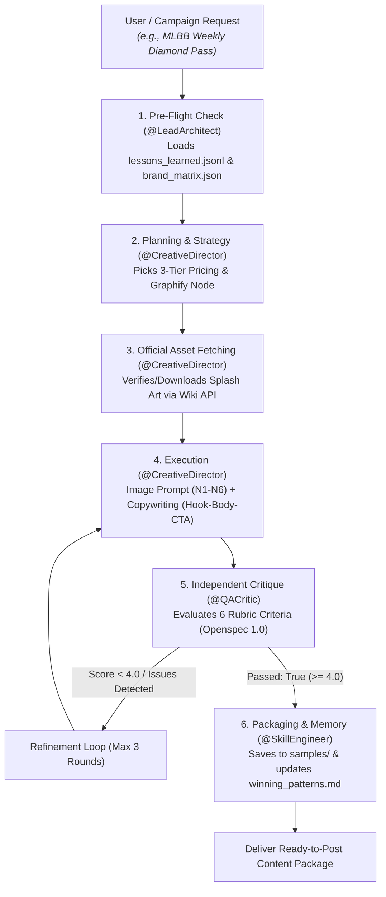

# Multi-Agent Social Commerce Content Engine (`content-gen`)

> **Turnkey, Production-Ready, Agent-Agnostic AI Framework** for automated social commerce content generation (In-Game Native HUD Image Prompts + High-Converting Captions + Independent QA Critic + Persistent Reflexion Memory).

Compatible out-of-the-box with **Antigravity IDE, Claude Code, Cursor, VS Code Copilot, Muse, Codex, Open Code, Hermes Agent, and OpenClaw**.

---

## 🌟 Overview & Problem Solved

Generating promotional content for digital products and gaming vouchers typically suffers from three major flaws when done with standard AI prompts:

1. **Hallucinated Prices:** Models invent prices, discounts, and currency packages that don't exist.
2. **Generic Stock-Photo Aesthetics:** AI generates ungrounded fantasy art that looks nothing like the official in-game event banners or licensed characters.
3. **Repeated Mistakes Across Sessions:** Without persistent memory, an agent repeats the same errors each time a new chat is opened.

**`content-gen`** solves all three with a **5-Persona Multi-Agent Architecture**:

- 🛡️ **Zero-Hallucination Pricing:** All nominal packages and IDR prices are strictly grounded in [`brand_matrix.json`](./content-gen/memory/brand_matrix.json) with verified `source_url` and `fetched_at`.
- 🎮 **In-Game Native UI & 2.5D Depth Layering (`N1`–`N6`):** Prompts generate visuals formatted like official in-game event announcements (flanked esports HUD banners, translucent chamfered glass cards, 2.5D character overlapping, isometric 3D currency badges, and contrast CTA pills).
- 🎨 **Official Character Grounding:** Automated MediaWiki fetcher downloads high-res splash art into [`assets/references/`](./content-gen/assets/references/) to feed directly into `generate_image(MediaPaths=[...])`.
- ⚖️ **Independent QA Critic:** Dedicated `@QACritic` evaluates every draft across a 6-criteria rubric with veto power (`score >= 4.0/5.0` required).
- 🧠 **Persistent Reflexion Loop:** Every correction is permanently recorded in [`lessons_learned.jsonl`](./content-gen/memory/lessons_learned.jsonl) and loaded during pre-flight checks in future sessions.

---

## 🏗️ Architecture & Multi-Agent Flow



### The 5 Agent Personas (`.agents/personas/*.md`)

| Persona | Role | Primary Responsibility |
| --- | --- | --- |
| **`@LeadArchitect`** | Architecture & Integrity | Enforces OpenSpec contracts, validates schema integrity, runs pre-flight checks, and configures brand rules. |
| **`@CompetitiveAnalyst`** | Evidence & Intelligence | Extracts public product catalogs (`brand_matrix.json`) and reverse-engineers competitor visual and copy anatomy (`competitor_patterns.md`). |
| **`@CreativeDirector`** | Creative Execution | Crafts In-Game HUD Image Prompts (`N1`–`N6`) and conversion-optimized captions (Hook-Body-CTA-Hashtags). |
| **`@QACritic`** | Quality Gate & Veto | Independent evaluator using a 6-criteria rubric. Never critiques its own authored text. |
| **`@SkillEngineer`** | Portability & Learning | Manages universal cross-harness compatibility, the append-only Reflexion Loop, and documentation. |

---

## 🚀 Quick Start Guide (By AI Model & IDE)

### 1. In Antigravity IDE

The skill is pre-linked via `.agents/skills/content-gen`.
Simply ask in the chat:

```text
Gunakan skill content-gen untuk membuat postingan feed 4:5 promo Mobile Legends Weekly Diamond Pass.
```

### 2. In Claude Code (CLI)

Claude Code automatically discovers [`CLAUDE.md`](./CLAUDE.md) and `.claude/skills/`.
Run directly from terminal:

```bash
claude "Jalankan META_PROMPT.md: buat konten promo Honor of Kings 80 Tokens angle push rank weekend."
```

### 3. In Cursor / VS Code Copilot / Muse / Codex / Open Code

Settings are picked up from [`.cursorrules`](./.cursorrules) and [`AGENTS.md`](./AGENTS.md).
In the assistant chat, paste:

```text
Bertindaklah sebagai Meta-Orchestrator sesuai instruksi di META_PROMPT.md.
Jalankan MODE 1 (Generate Konten) untuk produk: Free Fire 10 Diamond.
Terapkan Pre-Flight check dari lessons_learned.jsonl, susun Image Prompt standar N1-N6, Copywriting, dan tampilkan QA Critic Report.
```

### 4. In Hermes Agent / OpenClaw / Headless Pipeline

- **Contract Schema:** [`content-gen/openspec.yaml`](./content-gen/openspec.yaml)
- **State Machine Pipeline:** [`content-gen/workflows/ruflo_pipeline.yaml`](./content-gen/workflows/ruflo_pipeline.yaml)
- Invoke via tool-calling payload:

  ```json
  {
    "skill": "content-gen",
    "product_url": "https://akungame.id/topup/mobile-legends",
    "content_format": "feed_4x5",
    "campaign_angle": "push_rank_promo"
  }
  ```

---

## 🛠️ CLI Utilities & System Validation

### 1. Validate System Integrity

Run the built-in pre-flight validator to ensure all JSON schemas, memory files, and persona files are intact:

```bash
python3 scripts/validate_system.py
```

### 2. Fetch Official Game Character Splash Arts

Automatically query MediaWiki APIs to download authentic character renders into `assets/references/`:

```bash
python3 scripts/fetch_character_reference.py \
  --game mobile-legends \
  --query "Ruby Mecha Maiden" \
  --out content-gen/assets/references/ruby_aspirants.jpg
```

*Supported games: `mobile-legends`, `free-fire`, `honor-of-kings`, `valorant`.*

---

## 📁 Repository Structure

```text
.
├── META_PROMPT.md                # Universal Orchestration Meta-Prompt
├── AGENTS.md                     # Agent execution instructions & persona rules
├── CLAUDE.md                     # Claude Code workspace guidelines
├── .cursorrules                  # Cursor & VS Code assistant guidelines
├── .agents/
│   ├── personas/                 # Persona specs (@LeadArchitect, @QACritic, etc.)
│   └── skills/                   # Symlink to active skill
├── scripts/
│   ├── validate_system.py        # System & contract validation tool
│   └── fetch_character_reference.py # MediaWiki splash art fetcher
└── content-gen/                  # Core portable skill package
    ├── SKILL.md                  # Skill entrypoint & relative path manifest
    ├── openspec.yaml             # OpenSpec 1.0 schema contract
    ├── config/                   # Target brand voice & competitor sources
    ├── memory/                   # Grounded catalog, lessons learned, and graphs
    ├── prompts/                  # Modular prompts (Scraper, Image Builder, Copy, QA)
    ├── assets/references/        # Official splash art files
    ├── workflows/                # Ruflo state machine pipeline
    ├── samples/                  # Validated production-ready sample outputs
    └── docs/                     # Technical architecture documentation
```

---

## 🎨 Adapting to Your Own Brand (Mode 2)

To customize this framework for a different store or brand:

1. **Update Brand Config:** Edit [`content-gen/config/target_brand.yaml`](./content-gen/config/target_brand.yaml) with your store name, URL, brand voice, and official hex color codes.
2. **Update Competitors:** Edit [`content-gen/config/competitors.yaml`](./content-gen/config/competitors.yaml) to target relevant competitor accounts.
3. **Refresh Product Catalog:** Populate [`content-gen/memory/brand_matrix.json`](./content-gen/memory/brand_matrix.json) with verified product names, nominal amounts, and prices.
4. **Validate:** Run `python3 scripts/validate_system.py` to ensure all fields adhere to OpenSpec contracts.

---

## 📜 License

MIT License. Designed and maintained for production social commerce agent workflows.
